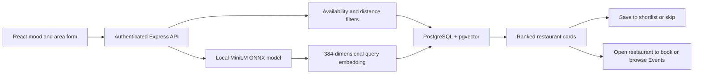

# Semantic discovery

Open **For you** from the right of the restaurant search bar to get restaurant recommendations. Browse EatTogether Events within each venue in Restaurant view or Map view. The EatTogether filter shows venues with upcoming Events or with seats available.

## Implemented flow

1. Enter a dining mood or describe what you want to eat. Optionally enter a Singapore neighbourhood or listed restaurant name to limit results to 15 km in a straight line. An empty location searches all venues. Unknown names return a validation error.
2. The server indexes changed venue and active Event descriptions with a local quantized MiniLM model. Content hashes avoid re-embedding unchanged records. New groups are indexed on the next search.
3. Restaurant recommendations require an active venue with a future slot that has enough free seats for its minimum party size. The server normalizes food terms and applies cuisine or menu constraints inferred from the entered text.
4. PostgreSQL ranks eligible `vector(384)` embeddings by cosine distance (`<=>`). Relevance thresholds can leave a search empty, and results are capped at six venues.
5. Swipe right to save or left to advance, or use the buttons or arrow keys. Undo restores the previous decision. The shortlist persists per account. A fresh search can return saved and skipped venues, and flags saved venues as shortlisted.
6. Open a restaurant to make an ordinary booking or browse its EatTogether Events. Joining checks diner eligibility and remaining seats. Confirmation is automatic at the Event minimum.

The API also supports Event ranking for compatibility and integration tests. The **For you** popup requests restaurant results.



Raw moods are processed in memory and are not persisted or sent to an external model provider. Stored vectors represent venue/group descriptions, not user identities. Ranking is descriptive similarity, not learned compatibility, a probability of enjoyment, or a dietary-safety guarantee. The interface deliberately avoids match percentages. Search failure reports an error instead of silently substituting keyword search.

## Offline operation and setup

`docker compose up --build -d` downloads packages and the pinned model during the initial build. Afterwards the model, photos, map, API and database run locally. Client devices still need LAN access to the running host; “offline” does not mean an installed app that works without its server. Source attribution links open external websites only when clicked.

The basemap contains 30,654 geographic features (~6.9 MB uncompressed). It supports zoom/pan, restaurant pins and a restaurant selector; selected venue details show upcoming EatTogether Events, including full tables. Restaurant cards, top picks and For you cards show upcoming Event counts; past, cancelled and expired Events are excluded. The same cuisine and restaurant search filters apply to grid and map. There is no live routing or device-location permission. The map covers western/central Singapore, not the whole country at street-navigation detail.

Existing fictional venue records are archived, not renamed or deleted, preserving earlier booking history. Eight real examples receive synthetic seven-day inventory. Seeded group IDs are stable per date and are not recreated after cancellation or confirmation. Existing user groups and bookings are preserved.

## Verification, 25 September 2026

- Both TypeScript builds and Docker builds passed.
- Local semantic integration test passed: Korean grilled-meat request → Seorae; frozen treats/waffles → 2SCOOPS; calm Japanese lunch → Joya; Italian pasta/pizza in restaurant mode → il Cielo.
- The same test verifies open-seat eligibility, NTU radius filtering, authentication, invalid filters, account-isolated saves, exclusion of decided cards, skip, and undo.
- Six PostgreSQL-backed booking/concurrency regression tests passed, plus two credential unit tests.
- A separate model invocation with Docker `--network none` returned 384 dimensions successfully.
- Browser checks: real photos, grid/map toggle, group filter, semantic results, shortlist save and undo. Phone-sized layout checked for overflow. A pointer swipe right saved a dessert group; keyboard left skipped it; undo restored both test decisions. Restaurant selection zoomed the map and showed the corresponding group.

These smoke tests cover the small demo catalog. Recommendation accuracy across a wider catalog and participant usability require separate evaluation.

```powershell
docker compose exec -T backend npm run test:discovery
docker compose exec -T backend npm run test:integration
docker compose exec -T backend npm test
```

## Practical limits

The English-language model ranks a small static catalog. Initial inference may take longer while the model loads. Indexing is serialized and search uses exact vector ranking. The last swipe can be undone within the current result deck.

An earlier dependency audit recorded five high-severity findings through the Prisma configuration/deepmerge tooling and Transformers.js/sharp dependency chains. The prototype performs text inference and uses public demo credentials.
