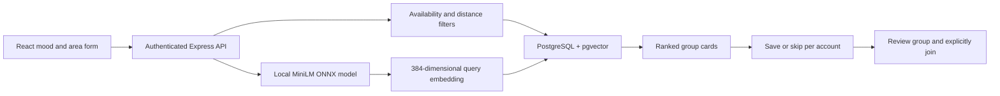

# Semantic discovery

“For you” opens as a popup from restaurant discovery and recommends restaurants only. The homepage has a Restaurants | EatTogether toggle for browsing upcoming Events separately. The selected homepage cuisine carries into the popup; cuisine is a strict eligibility constraint before vector ranking. Saving expresses interest, while booking or joining remains an explicit action on the restaurant page.

## Implemented flow

1. Enter a dining mood, optionally select a cuisine, and optionally type a neighbourhood or listed restaurant name and a radius. The form starts empty; only an explicitly selected homepage cuisine carries in.
2. The server indexes changed venue and active Event descriptions with a local quantized MiniLM model. Content hashes avoid re-embedding unchanged records. New groups are indexed on the next search.
3. Restaurant recommendations require an active venue, an unallocated future slot and the selected cuisine. The retained Event-search API excludes past, full and inactive-venue Events. Confirmed Events with remaining seats stay eligible; occupancy sums Party sizes. Other exclusions cover Events already joined and the account’s saved/skipped cards. Restaurant mode requires an unallocated future slot. A radius uses straight-line distance from a local neighbourhood centre or restaurant coordinates. Blank location searches all venues; unknown names return a validation message. No external geocoding service is used.
4. PostgreSQL `vector(384)` ranks eligible candidates using cosine distance (`<=>`). This is actual dense-vector retrieval, not keyword matching or a fixed list.
5. Swipe right/save, left/skip, or use buttons/keyboard arrows. Undo restores the previous decision. Shortlists persist in PostgreSQL per account.
6. Open a saved restaurant to book privately or discover its EatTogether Events. Confirmation is automatic when total diners reach the slot minimum; joining revalidates Party size and remaining seats.

The API also retains Event ranking for compatibility and integration coverage; the following existing diagram illustrates that API path rather than the current restaurant-only popup.



Raw moods are processed in memory and are not persisted or sent to an external model provider. Stored vectors represent venue/group descriptions, not user identities. Ranking is descriptive similarity, not learned compatibility, a probability of enjoyment, or a dietary-safety guarantee. The interface deliberately avoids match percentages. Search failure reports an error instead of silently substituting keyword search.

## Offline operation and setup

`docker compose up --build -d` downloads packages and the pinned model during the initial build. Afterwards the model, photos, map, API and database run locally. Client devices still need LAN access to the running host; “offline” does not mean an installed app that works without its server. Source attribution links open external websites only when clicked.

The basemap contains 30,654 geographic features (~6.9 MB uncompressed). It supports zoom/pan, restaurant pins and a restaurant selector; selected venue details show upcoming EatTogether Events, including full tables. Restaurant cards, top picks and For you cards show upcoming Event counts; past, cancelled and expired Events are excluded. The same cuisine and restaurant search filters apply to grid and map. There is no live routing or device-location permission. The map covers western/central Singapore, not the whole country at street-navigation detail.

Existing fictional venue records are archived, not renamed or deleted, preserving earlier booking history. Eight real examples receive synthetic seven-day inventory. Seeded group IDs are stable per date and are not recreated after cancellation or confirmation. Existing user groups and bookings are preserved.

## Verification, 25 September 2026

- Both TypeScript builds and Docker builds passed.
- Local semantic integration test passed: Korean grilled-meat request → Seorae; frozen treats/waffles → 2SCOOPS; calm Japanese lunch → Joya; Italian pasta/pizza in restaurant mode → il Cielo.
- The same test verifies open-seat eligibility, NTU radius filtering, authentication, invalid filters, account-isolated saves, exclusion of decided cards, skip, and undo.
- Six PostgreSQL-backed booking/concurrency regression tests passed, plus two credential unit tests.
- A separate model invocation with Docker `--network none` returned 384 dimensions successfully.
- Browser checks: real photos, grid/map toggle, group filter, semantic results, shortlist save and undo. Phone-sized layout checked for overflow. A pointer swipe right saved a dessert group; keyboard left skipped it; undo restored both test decisions. Restaurant selection zoomed the map and showed the corresponding group.

These are engineering smoke tests on a small curated catalog, not evidence of product-market fit or broad recommendation accuracy. The report should separately present participant usability testing, task completion and time-to-find-a-group. A held-out query benchmark against a lexical baseline is a useful next evaluation; do not claim it has already been conducted.

```powershell
docker compose exec -T backend npm run test:discovery
docker compose exec -T backend npm run test:integration
docker compose exec -T backend npm test
```

## Practical limits

Small English-language model, small static catalog, no collaborative learning or reranking from likes, no live Eatigo availability. Saved groups can fill or expire; joining revalidates availability. A skip persists across searches; the last swipe can be undone during the current page session. Initial inference may take longer while the model loads. Indexing is serialized and exact vector search is appropriate for this demo’s scale; a large catalog would need background indexing, bounded work queues and retrieval evaluation.

Dependency audit still reports five high findings through the Prisma configuration/deepmerge tooling and Transformers.js/sharp dependency chains. This prototype performs text inference only and accepts no image uploads, but the findings remain unresolved and should be addressed before any public deployment. Demo authentication uses seeded credentials.
